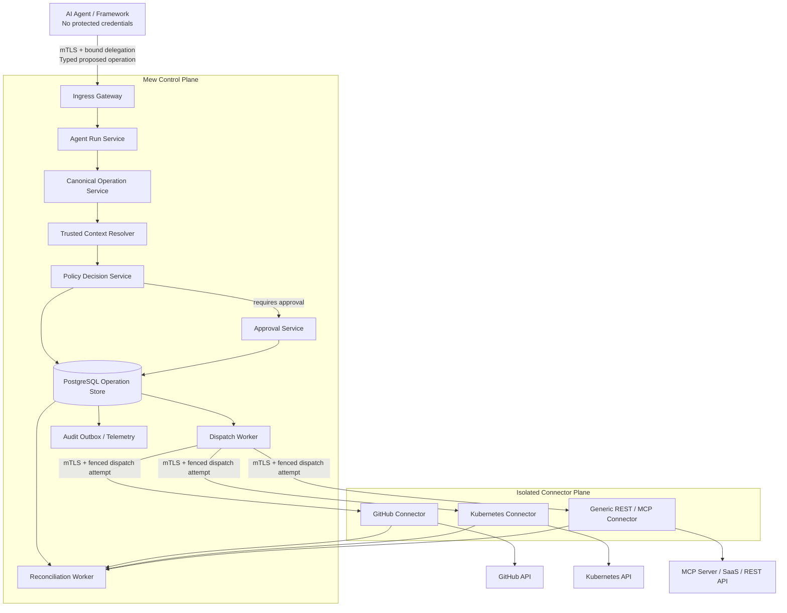
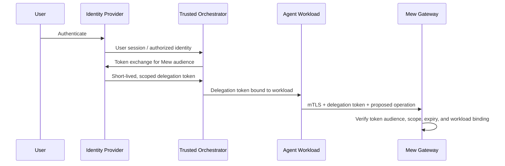
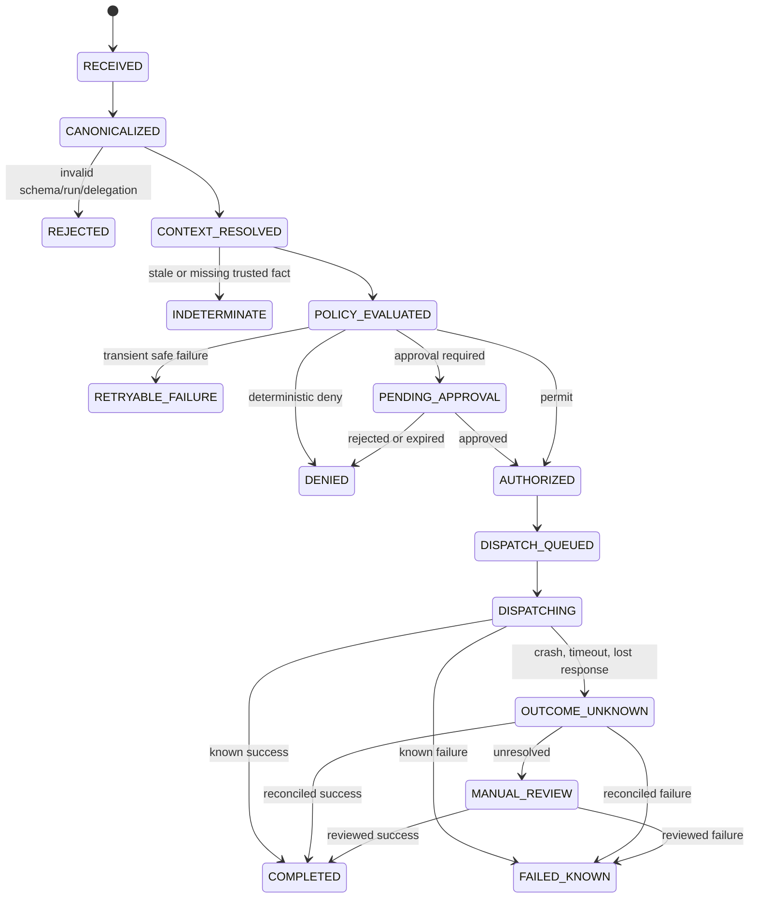
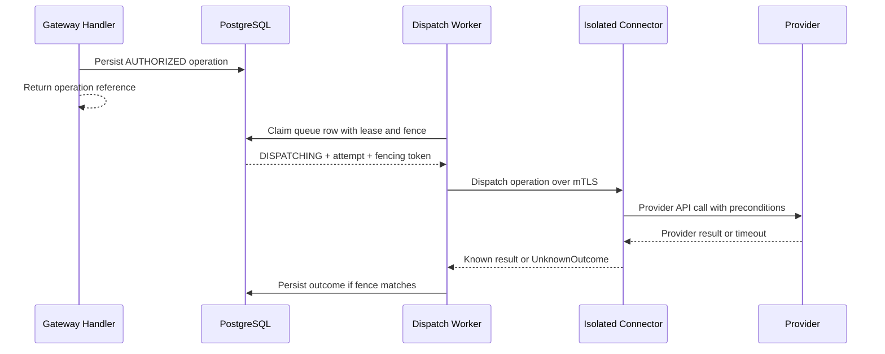
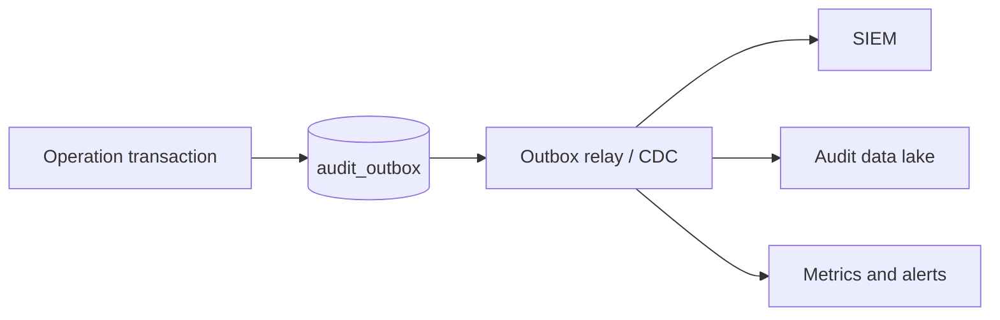
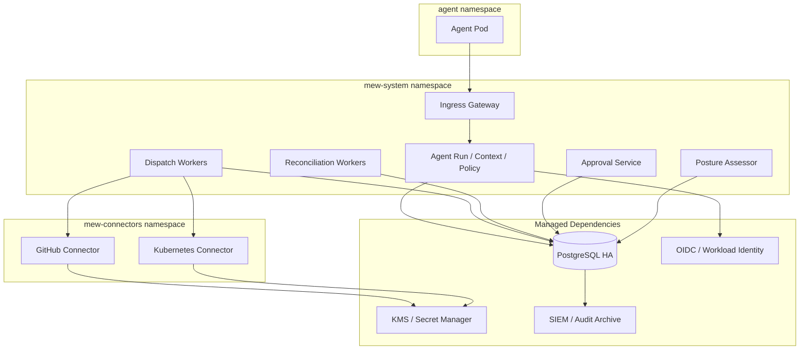

# Mew
## High-Assurance Execution Gateway for Autonomous Agents

**Document type:** Product and reference system architecture  
**Status:** Build specification — v1 scope  
**Audience:** Security architects, platform engineers, connector developers, SREs, and technical evaluators  
**Primary deployment:** Self-hosted, Kubernetes-based enterprise environment  

---

## Executive summary

Mew is a credential-isolating, policy-enforcing execution gateway for autonomous AI agents. It sits between an agent and protected systems such as GitHub, Kubernetes, cloud control planes, databases, CI/CD platforms, MCP servers, and SaaS APIs.

Mew does **not** attempt to prove that a language model understood a human request, that a third-party system behaved correctly, or that an operation is universally “safe.” Instead, it enforces a narrower and testable control loop:

1. An agent proposes a **typed operation**.
2. Mew verifies workload identity, delegated authority, and current deployment-posture evidence.
3. Mew canonicalizes the operation, resolves trusted context, and evaluates deterministic policy.
4. Mew records an idempotent operation and dispatches it through an isolated connector holding narrowly scoped credentials.
5. Mew requires connector-specific preconditions and treats uncertain external results as `OUTCOME_UNKNOWN`.
6. Mew reconciles uncertainty instead of blindly retrying potentially destructive actions.
7. Mew emits durable evidence for every decision, state transition, approval, dispatch attempt, and known limitation.

The primary v1 wedge is **high-assurance execution for AI coding and infrastructure agents**, beginning with GitHub pull-request merge operations. Mew is not a generic LLM proxy, a replacement ledger, a universal MCP marketplace, or a broad compliance product.

> **Core promise:** In a conforming deployment, an agent does not hold credentials for protected target systems. It can propose a typed action to Mew, but Mew alone decides whether to dispatch it and performs the provider call through an isolated, least-privilege connector.

---

## Contents

1. [Product boundary](#1-product-boundary)
2. [Security claims and limits](#2-security-claims-and-limits)
3. [Architecture overview](#3-architecture-overview)
4. [Trust model](#4-trust-model)
5. [Deployment posture evidence](#5-deployment-posture-evidence)
6. [Identity, delegation, and agent runs](#6-identity-delegation-and-agent-runs)
7. [Canonical operations](#7-canonical-operations)
8. [Trusted context resolution](#8-trusted-context-resolution)
9. [Deterministic policy](#9-deterministic-policy)
10. [Approvals](#10-approvals)
11. [Data-flow and quota controls](#11-data-flow-and-quota-controls)
12. [Connector architecture](#12-connector-architecture)
13. [Operation lifecycle](#13-operation-lifecycle)
14. [Dispatch, leases, and recovery](#14-dispatch-leases-and-recovery)
15. [Reconciliation and manual review](#15-reconciliation-and-manual-review)
16. [Storage and data protection](#16-storage-and-data-protection)
17. [Audit and observability](#17-audit-and-observability)
18. [GitHub vertical slice](#18-github-vertical-slice)
19. [MCP and generic REST mediation](#19-mcp-and-generic-rest-mediation)
20. [Operational architecture](#20-operational-architecture)
21. [Testing and release gates](#21-testing-and-release-gates)
22. [Failure handling](#22-failure-handling)
23. [Delivery roadmap](#23-delivery-roadmap)
24. [Explicit non-goals](#24-explicit-non-goals)

---

# 1. Product boundary

## 1.1 Problem

Autonomous agents can propose and execute privileged operations through tools, MCP servers, shells, SaaS APIs, cloud APIs, databases, and CI/CD systems. The dangerous boundary is not the text model itself; it is the transition from untrusted agent-generated intent to an irreversible external side effect.

An agent can be manipulated by prompt injection, tool-output injection, malicious retrieval content, ambiguous instructions, stale context, hallucinated parameters, compromised memory, or ordinary software defects. A secure system must assume that the agent’s proposed tool arguments are hostile input.

## 1.2 Product position

Mew is an **execution gateway**, not an advisory policy library.

```text
Agent proposes operation
        |
        v
Mew validates, authorizes, records, and dispatches
        |
        v
Isolated connector performs provider call
        |
        v
Protected external system executes or rejects
```

The agent receives no privileged provider credential and no broadly reusable authorization token.

## 1.3 Initial supported action families

Mew v1 should prioritize action families with typed APIs, provider-side state preconditions, meaningful reconciliation paths, and independent provider controls:

| Priority | Action family | First example |
|---:|---|---|
| 1 | Source control | GitHub pull-request merge |
| 2 | Kubernetes operations | Deploy, rollback, scale, delete within namespace |
| 3 | CI/CD | Promote release, rollback release, change feature flag |
| 4 | Database change | Execute immutable migration artifact |
| 5 | Cloud control plane | Scoped IAM or infrastructure change |

## 1.4 Non-authoritative domains

The following inputs are never authorization evidence by themselves:

- LLM output
- User prompt text
- Agent memory
- Retrieval content
- Tool descriptions
- MCP tool annotations
- Tool output
- Agent-selected session IDs
- Agent-provided human principal identifiers
- Agent-provided balance, quota, ownership, role, or approval values

---

# 2. Security claims and limits

## 2.1 What Mew can claim

For each Mew-mediated operation, Mew can provide evidence that:

- A known workload identity submitted the operation over authenticated transport.
- Any human delegation was verified from a trusted issuer rather than accepted from agent text.
- The operation matched a typed schema and was canonicalized deterministically.
- The decision used an immutable policy bundle and a recorded set of trusted context facts.
- Required approval was bound to the canonical operation, preconditions, policy digest, and expiry.
- A connector with a declared contract dispatched the operation using its own scoped credential.
- The operation was either completed, known to have failed, or placed in explicit uncertain/reconciliation state.
- Deployment-posture evidence available at decision time was retained with the decision record.

## 2.2 What Mew must not claim

Mew must not claim that it:

- Proves model intent is correct.
- Proves an external API has executed correctly unless provider evidence establishes it.
- Prevents bypasses outside the observed and assessed deployment boundary.
- Atomically reserves state in arbitrary external systems.
- Detects behavioral changes behind an unchanged generic MCP/REST manifest.
- Eliminates the blast radius of a compromised connector credential.
- Replaces provider-side authorization, branch protections, cloud IAM, database controls, or customer governance.
- Establishes regulatory compliance by itself.

## 2.3 Security theorem — scoped form

For a canonical operation `O`, Mew permits dispatch only if:

```text
AuthenticatedWorkload(O)
AND ValidAgentRun(O)
AND ValidDelegationOrServiceAuthority(O)
AND ValidPostureEvidence(O)
AND CanonicalTypedOperation(O)
AND TrustedContextAvailable(O)
AND DeterministicPolicyPermits(O)
AND RequiredApprovalValid(O)
AND QuotaAndDataFlowPermits(O)
AND ConnectorContractSupports(O)
```

Any missing, stale, invalid, conflicting, or unverifiable input blocks dispatch.

---

# 3. Architecture overview

## 3.1 Logical topology



## 3.2 Planes

| Plane | Responsibility | Security boundary |
|---|---|---|
| Agent execution plane | Generates proposed operations | Untrusted for authorization semantics |
| Mew control plane | Identity, canonicalization, context, policy, state, dispatch orchestration | Core trusted computing base |
| Connector plane | Provider-specific translation and execution | Separate TCB component per connector |
| Provider plane | GitHub, Kubernetes, cloud, database, SaaS | External system of record / independent enforcement |
| Evidence plane | Audit, telemetry, posture assessment, policy artifacts | Sensitive but non-authoritative for immediate dispatch |

---

# 4. Trust model

## 4.1 Trusted computing base

The Mew TCB consists of:

- Ingress mTLS and workload identity validation.
- Agent run issuance and binding.
- Delegation-token verification.
- Canonical operation implementation.
- Trusted context resolver and source adapters.
- Policy evaluator and approved policy bundle.
- PostgreSQL operation-state integrity.
- Dispatch worker lease and fencing protocol.
- Connector implementation for each protected provider.
- Connector credential mechanism.
- Approval page and approval artifact verification.
- Deployment Posture Assessor identity and evidence validation.
- Build pipeline, artifact signing, image admission, and runtime configuration.

## 4.2 Trust table

| Component | Trusted for | Not trusted for |
|---|---|---|
| Agent | Proposing work only | Identity claims in payload, authorization, provider facts |
| LLM | Semantic suggestion only | Any security-critical fact or action authority |
| Gateway | Request admission and orchestration | Provider outcome unless connector/provider evidence confirms it |
| Context resolver | Verified fact assembly | Agent-supplied fact values |
| Policy service | Decision over typed request/facts | Truth of stale or compromised upstream source |
| Connector | Provider request construction | Broad independent authority beyond credential scope |
| Provider | Own system state and outcome | Mew policy correctness |
| Posture assessor | Time-bounded posture evidence | Absolute proof of no bypass |
| SIEM | Evidence retention | Authorization availability |

---

# 5. Deployment posture evidence

## 5.1 Purpose

Mew cannot enforce calls that never reach Mew. A deployment assessment therefore records evidence about whether known bypass paths were tested and absent at a point in time.

It is **not** a proof that bypass is impossible.

## 5.2 Assessment statuses

| Status | Meaning |
|---|---|
| `BYPASS_CONFIRMED` | An active probe found a direct path to a protected target |
| `BYPASS_POSSIBLE` | Configuration or incomplete evidence indicates a plausible bypass |
| `NO_KNOWN_BYPASS_ATTESTED` | Configuration and active probes found no known bypass at assessment time |
| `PARTIALLY_ASSESSED` | Required checks are incomplete |
| `UNASSESSED` | No usable posture evidence exists |
| `ASSESSMENT_INVALID` | Evidence expired or relevant deployment state changed |

## 5.3 Active probe model

The Deployment Posture Assessor performs both inspection and active probing from the agent’s effective runtime context.

| Probe | Example expected result |
|---|---|
| Direct provider egress | `api.github.com:443` blocked or only available through approved proxy |
| Secret discovery | No GitHub token, SSH key, kubeconfig, cloud token, or connector secret available |
| Credential helper inspection | No usable Git credential or browser session |
| Metadata endpoint access | No privileged cloud metadata credential available |
| Kubernetes API access | Denied unless required and tightly scoped |
| Connector access | Agent cannot invoke connector directly without gateway identity |
| Shell route | CLI/browser/curl path cannot bypass protected egress controls |

## 5.4 Evidence record

```text
assessment_id
agent_workload_id
tenant_id
environment
assessor_identity
assessor_version
assessed_at
valid_until
configuration_findings
active_probe_results
known_bypass_paths
unknown_paths
status
evidence_digest
```

Every operation decision references the current assessment ID and its validity interval.

---

# 6. Identity, delegation, and agent runs

## 6.1 Workload identity

Every agent and connector has a distinct workload identity. Production deployments use mTLS and, where available, SPIFFE/SPIRE or an equivalent workload identity system.

```text
spiffe://tenant.example/prod/mew/gateway
spiffe://tenant.example/prod/agents/release-agent
spiffe://tenant.example/prod/mew/connectors/github
spiffe://tenant.example/prod/mew/connectors/kubernetes
```

## 6.2 Human delegation

A raw user access token must not be handed to an agent for presentation to Mew. That recreates a bearer-token problem.

Preferred flow:



The delegation token must be:

- Short-lived.
- Audience-restricted to Mew.
- Scoped to tenant, environment, action family, and time window.
- Bound to the agent workload identity where supported.
- Issued by a trusted identity provider or orchestrator.
- Useless as a provider credential for GitHub, cloud, database, or SaaS calls.

## 6.3 Gateway-issued agent run

The agent cannot choose its session or run ID. Mew issues an opaque `agent_run_id` after validating workload identity, delegation, and posture evidence.

```text
agent_run_id
tenant_id
environment
workload_id
delegated_principal_id
delegation_id
posture_assessment_id
taint_level
created_at
expires_at
revoked_at
```

The run is bound to workload identity, tenant, environment, delegation, and posture. It prevents agents from simply creating a new agent-supplied session identifier to evade session-bound controls.

---

# 7. Canonical operations

## 7.1 Design rule

Mew authorizes typed operations, not raw natural-language commands or arbitrary JSON blobs.

## 7.2 Common envelope

```text
schema_version
operation_id
agent_run_id
idempotency_key
tenant_id
environment
authenticated_workload_id
delegated_principal_id
delegation_id
connector_id
connector_version
operation_type
target_reference
payload_type
typed_payload
preconditions
policy_context_digest
posture_assessment_id
created_at
expires_at
canonical_request_hash
```

## 7.3 Encoding and hashing

For v1:

- External API transport may use JSON with strict schema validation.
- Mew converts validated input into a single internal canonical representation.
- Canonical encoding uses deterministic CBOR.
- The request hash is domain-separated and computed from canonical bytes.
- JSON duplicate keys, implicit coercions, number ambiguity, Unicode normalization issues, and unknown security-relevant fields are rejected before canonicalization.

```text
request_hash = SHA-256(
  "mew/canonical-operation/v1\\0" || canonical_cbor_bytes
)
```

## 7.4 Preconditions

Every mutating typed operation must declare provider-supported preconditions when available.

```text
preconditions:
  - type: GITHUB_EXPECTED_HEAD_SHA
    value: "a5c1..."
  - type: KUBERNETES_RESOURCE_VERSION
    value: "729183"
  - type: HTTP_ETAG
    value: "\"e84f...\""
  - type: MIGRATION_ARTIFACT_DIGEST
    value: "sha256:..."
```

Preconditions are part of the request hash and approval binding. A connector must not silently refresh a precondition and execute against new state.

---

# 8. Trusted context resolution

## 8.1 Purpose

The context resolver supplies the facts that policy needs but that an agent cannot be trusted to provide.

## 8.2 Fact sources

| Fact | Example source | Failure behavior |
|---|---|---|
| Workload identity | mTLS identity provider | Deny |
| Delegated principal | Token issuer / trusted orchestrator | Deny |
| Role/group membership | IdP or static entity registry | Deny for high-risk action if stale |
| Resource ownership | Provider metadata / resource registry | Re-resolve or deny based on risk |
| Target classification | Connector configuration | Deny if unknown for controlled data flow |
| Tool manifest | Approved manifest registry | Deny on mismatch |
| Policy bundle | Signed artifact registry | Deny if invalid/unavailable |
| Quota state | Mew PostgreSQL | Retryable failure or deny by risk class |
| Approval state | Mew approval store | Deny if missing/expired |

## 8.3 Fact record

```text
fact_type
subject_reference
value
source_system
source_version
retrieved_at
valid_until
integrity_status
classification
```

The policy decision records a digest of all relevant facts and source versions.

---

# 9. Deterministic policy

## 9.1 Runtime engine

Mew v1 chooses one primary policy engine: Cedar **or** OPA/Rego. It does not ship two equally supported policy engines in the first product.

## 9.2 Outcomes

```text
PERMIT
DENY
REQUIRES_APPROVAL
RETRYABLE_FAILURE
INDETERMINATE
```

## 9.3 Merge precedence

```text
DENY
  > INDETERMINATE
  > RETRYABLE_FAILURE
  > REQUIRES_APPROVAL
  > PERMIT
```

A request that requires approval must still complete all deterministic policy checks. A policy approval result never hides a deterministic denial or missing trusted fact.

## 9.4 Policy layers

```text
Platform baseline
AND organization policy
AND tenant policy
AND connector policy
AND action-specific policy
AND data-flow policy
AND quota policy
AND approval policy
```

No lower layer can convert an upstream denial into a permit.

## 9.5 Offline formal analysis

Formal analysis is optional and offline in v1. It may validate policy bundles for contradictions, unreachable rules, unintended permit paths, and separation-of-duties constraints. It is not a live dependency for tool execution.

---

# 10. Approvals

## 10.1 Approval rule

Approvers must see the canonical operation, not agent prose or a mutable model summary.

## 10.2 Approval page

The Project1-hosted approval page is part of the TCB. It renders only canonical operation fields, trusted facts, policy result, preconditions, and connector-defined impact data.

Example display:

```text
Action: Merge pull request
Repository: acme/payments-service
Pull request: #482
Base branch: main
Expected head SHA: a5c1...
Merge method: squash
Requested by workload: release-agent
Acting for: user@example.com
Policy bundle digest: sha256:...
Request hash: sha256:...
Posture assessment: NO_KNOWN_BYPASS_ATTESTED
Approval expiry: 2026-10-05T06:32:00Z
```

## 10.3 Approval artifact

```text
approval_id
operation_id
canonical_request_hash
precondition_digest
policy_bundle_digest
approver_principal_id
approver_role
approval_method
approved_at
expires_at
approval_nonce
decision
```

## 10.4 Assurance levels

| Level | Mechanism | Claim |
|---|---|---|
| `APPLICATION_BOUND` | Mew-rendered page plus authenticated session | User approved the displayed canonical operation |
| `PHISHING_RESISTANT` | WebAuthn or comparable proof | Stronger user-presence and identity evidence |
| `INTEGRATED_WORKFLOW` | Verified enterprise workflow binding | Depends on workflow integration quality |
| `WEBHOOK_WEAK` | Slack/Jira/Teams webhook | Convenience path; not for highest-risk dispatch |

The v1 vertical slice uses `APPLICATION_BOUND`.

---

# 11. Data-flow and quota controls

## 11.1 Classification hierarchy

```text
PUBLIC < INTERNAL < CONFIDENTIAL < RESTRICTED < SECRET
```

## 11.2 Session taint

Mew applies coarse, monotonic taint to each gateway-issued agent run:

```text
new_taint = max(old_taint, classification_of_mediated_read)
```

A mediated write is permitted only if:

```text
destination_clearance >= agent_run_taint
```

This is intentionally conservative. It covers only data observed through Mew-mediated reads and writes in the current agent run.

## 11.3 Declassification

V1 permits only explicit, policy-controlled declassification, normally with human approval.

```text
source classification
target classification
approved transformation reference
approver reference
request hash
policy digest
expiry
audit evidence
```

## 11.4 Quotas

Quotas constrain the operation before dispatch. They are not merely counters updated afterward.

| Action | Pre-dispatch bound |
|---|---|
| Database export | Enforced `LIMIT`, allowed columns, query-cost ceiling |
| SaaS export | Page-size cap and cursor/page budget |
| File retrieval | Maximum object size and allowed prefix |
| External messaging | Recipient, domain, message, and byte caps |
| Kubernetes bulk action | Namespace and resource-cardinality cap |

Quota consumed by an operation remains held during `OUTCOME_UNKNOWN`. Releasing quota while external outcome is unknown can enable duplicate high-impact use.

---

# 12. Connector architecture

## 12.1 Isolation

Each connector is an isolated workload with separate:

- Workload identity.
- Provider credential reference.
- Egress allowlist.
- Runtime namespace/account.
- Resource limits.
- Audit identity.
- Credential scope.

A GitHub connector cannot access Kubernetes credentials; a Kubernetes connector cannot access GitHub credentials.

## 12.2 Connector contract

Every connector implements:

```text
validate(operation) -> ValidationResult

prepare_dispatch(operation, dispatch_attempt) -> ProviderRequestPlan

dispatch(operation, dispatch_attempt, provider_request_fingerprint)
  -> KnownSuccess | KnownFailure | UnknownOutcome

lookup_outcome(operation, dispatch_attempt, provider_request_fingerprint)
  -> KnownSuccess | KnownFailure | StillUnknown

compensate(operation, known_success_receipt)
  -> CompensationResult
```

Compensation is optional and must never be assumed safe.

## 12.3 Connector manifest

```text
connector_id
connector_version
provider
supported_operation_types
supported_resource_types
schema_digest
tool_manifest_digest
credential_model
credential_scope
egress_allowlist
effect_class
idempotency_class
precondition_support
outcome_lookup_support
compensation_support
retry_policy
data_classification_behavior
known_failure_modes
```

## 12.4 Connector tiers

| Tier | Requirements | Guarantee |
|---|---|---|
| Tier 1 | Typed request, native idempotency, preconditions, strong lookup | Strongest recovery semantics |
| Tier 2 | Typed request, preconditions, lookup, no native idempotency | No blind retry; may require review |
| Tier 3 | Fixed REST schema, partial recovery | Argument and operational constraints |
| Tier 4 | Generic MCP/REST mediation | Manifest/tool/argument controls only |
| Tier 5 | Unmanaged integration | Advisory/audit only |

---

# 13. Operation lifecycle



## 13.1 Invariants

```text
No provider call before AUTHORIZED.
No provider call from HTTP request handler.
No automatic retry from OUTCOME_UNKNOWN unless connector proves provider-native idempotency.
No stale lease holder can write a later outcome.
No approval survives request/precondition/policy/expiry mismatch.
No high-risk quota is silently released while outcome remains unknown.
```

---

# 14. Dispatch, leases, and recovery

## 14.1 Why dispatch is asynchronous

The HTTP handler validates and persists work. A dedicated worker performs the external side effect. This avoids client disconnects, replica races, long-lived request threads, and database transactions spanning external calls.

## 14.2 Lease protocol



### Claim transaction

```text
1. Begin short transaction.
2. Select eligible operation with FOR UPDATE SKIP LOCKED.
3. Create dispatch_attempt row.
4. Set operation state to DISPATCHING.
5. Set lease owner and lease expiry.
6. Increment fencing token.
7. Persist provider request fingerprint.
8. Commit.
9. Call connector outside transaction.
```

## 14.3 Fencing

The worker may write an outcome only if the dispatch attempt and fencing token still match the operation’s active attempt. This prevents stale workers from overwriting recovery state.

## 14.4 Default retry rule

> Dispatch is at-most-once by default. An expired lease or uncertain call transitions to `OUTCOME_UNKNOWN`; it does not cause automatic redispatch.

---

# 15. Reconciliation and manual review

## 15.1 Unknown outcome sources

```text
Gateway crashes after recording DISPATCHING but before connector call.
Gateway loses connector response.
Connector crashes after sending provider request.
Connector loses provider response.
Provider accepted request but network response is lost.
```

All converge on `OUTCOME_UNKNOWN`.

## 15.2 Provider request fingerprint

Before dispatch, Mew stores:

```text
provider_request_fingerprint = SHA-256(
  connector_id || connector_version || operation_id ||
  target_reference || normalized_provider_request || preconditions
)
```

The fingerprint supports correlation, reconciliation, audit evidence, and retry safety checks.

## 15.3 Manual-review case

```text
review_case_id
operation_id
assigned_queue
owner
opened_at
review_due_at
escalation_at
quota_hold_id
resolution
resolution_evidence
```

| Condition | Quota result |
|---|---|
| Known failure before provider acceptance | Release allowed |
| Known success | Consume |
| Unknown under reconciliation | Retain |
| Manual review pending | Retain |
| Review proves never dispatched | Release |
| Review proves success | Consume |
| Deadline exceeded for high-risk action | Escalate; do not silently release |

---

# 16. Storage and data protection

## 16.1 Data model

### `operations`

```text
operation_id UUID PRIMARY KEY
tenant_id TEXT NOT NULL
environment TEXT NOT NULL
agent_run_id UUID NOT NULL
authenticated_workload_id TEXT NOT NULL
delegated_principal_id TEXT NULL
delegation_id TEXT NULL
idempotency_key TEXT NOT NULL
canonical_request_hash BYTEA NOT NULL
connector_id TEXT NOT NULL
connector_version TEXT NOT NULL
operation_type TEXT NOT NULL
target_reference TEXT NOT NULL
state TEXT NOT NULL
decision TEXT NULL
policy_bundle_version TEXT NOT NULL
policy_bundle_digest BYTEA NOT NULL
fact_set_digest BYTEA NOT NULL
precondition_digest BYTEA NULL
posture_assessment_id UUID NULL
payload_blob_reference UUID NULL
provider_operation_id TEXT NULL
provider_request_fingerprint BYTEA NULL
approval_id UUID NULL
quota_hold_id UUID NULL
created_at TIMESTAMPTZ NOT NULL
updated_at TIMESTAMPTZ NOT NULL
expires_at TIMESTAMPTZ NULL
retention_until TIMESTAMPTZ NOT NULL

UNIQUE (tenant_id, authenticated_workload_id, idempotency_key)
```

### `dispatch_attempts`

```text
dispatch_attempt_id UUID PRIMARY KEY
operation_id UUID NOT NULL
attempt_number INTEGER NOT NULL
lease_owner_id TEXT NULL
lease_fencing_token BIGINT NOT NULL
lease_acquired_at TIMESTAMPTZ NULL
lease_expires_at TIMESTAMPTZ NULL
dispatch_started_at TIMESTAMPTZ NULL
connector_received_at TIMESTAMPTZ NULL
provider_request_fingerprint BYTEA NOT NULL
provider_request_reference TEXT NULL
state TEXT NOT NULL
outcome_receipt_reference TEXT NULL
created_at TIMESTAMPTZ NOT NULL
updated_at TIMESTAMPTZ NOT NULL
```

### Other required tables

```text
agent_runs
posture_assessments
approvals
quota_holds
audit_outbox
operation_payload_blobs
manual_review_cases
connector_manifests
policy_bundles
```

## 16.2 Sensitive payload rules

- Encrypt payload blobs per tenant using envelope encryption.
- Store metadata and hash in `operations`; store sensitive material in encrypted blob storage/table.
- Use row-level security as defense in depth.
- Restrict decryption to connector/reconciliation paths that need it.
- Apply per-classification retention policy.
- Do not persist raw prompts or raw tool outputs by default.
- Support cryptographic erasure through tenant-key destruction where appropriate.

---

# 17. Audit and observability

## 17.1 Audit event fields

```text
event_id
event_type
timestamp
operation_id
agent_run_id
tenant_id
environment
workload_id
delegated_principal_id
connector_id
connector_version
operation_type
canonical_request_hash
precondition_digest
policy_bundle_digest
fact_set_digest
posture_assessment_id
posture_status
decision
reason_codes
dispatch_attempt_id
provider_request_fingerprint
provider_operation_id
state_before
state_after
trace_id
```

## 17.2 Transactional outbox



The SIEM is not required for a decision to be made. The durable operation and outbox records are the local evidence source.

## 17.3 Required metrics

- Decisions by outcome and reason code.
- Policy evaluation latency.
- Context-source freshness failures.
- Posture assessment validity failures.
- Dispatch lease contention and expiry.
- Unknown-outcome rate per connector.
- Reconciliation age and backlog.
- Manual-review backlog and SLA breaches.
- Idempotency conflicts.
- Manifest mismatches.
- Quota holds retained due to uncertainty.
- Connector credential failures.
- Direct bypass probe success/failure.

---

# 18. GitHub vertical slice

## 18.1 Purpose

The first implementation validates the actual product thesis: Mew can mediate one dangerous operation, enforce a provider precondition, survive crashes without blind duplication, and produce evidence.

## 18.2 Supported operation

```text
github.merge_pull_request
```

## 18.3 Required payload

```text
repository_owner
repository_name
repository_id
pull_request_number
base_branch
merge_method
expected_head_sha
```

## 18.4 Connector classification

GitHub merge is Tier 2:

| Property | Status |
|---|---|
| Typed schema | Yes |
| Provider precondition | Yes: expected head SHA |
| Provider-native idempotency | No generic documented key |
| Outcome lookup | Yes, with correlation evidence |
| Compensation | Not safe as generic automatic action |
| Default retry | Never blindly retry |

## 18.5 Provider call requirements

The connector must:

- Use a GitHub App installation token restricted to approved repositories and scopes.
- Send `expected_head_sha` to the merge endpoint.
- Include the Mew operation ID and request hash in merge metadata where merge strategy permits.
- Record GitHub provider response identifiers and merge commit SHA.
- Never retry a merge automatically after uncertainty.

Example marker:

```text
Commit title:
Merge PR #482 [Mew: op_01H...]

Commit message:
Mew-Operation-ID: op_01H...
Mew-Request-Hash: sha256:...
Mew-Expected-Head-SHA: a5c1...
```

## 18.6 Reconciliation requirements

A merged PR is attributed to Mew only when all relevant evidence matches:

```text
repository matches
AND pull request matches
AND expected head SHA matches
AND merged commit evidence matches
AND Mew operation marker matches
```

A PR merely being “merged” is insufficient because a human or another automation system may have merged it.

## 18.7 Independent controls

Mew requires provider-side GitHub controls:

- GitHub App installed only on approved repositories.
- Protected branches and rulesets.
- Required reviews.
- Required status checks.
- CODEOWNERS where applicable.
- Merge queue/environment protection where applicable.
- Organization audit logging.

Mew does not replace GitHub-native security controls.

---

# 19. MCP and generic REST mediation

## 19.1 Scope

Generic connectors are useful but weaker than typed connectors. They must not be marketed as semantic safety controls.

## 19.2 Manifest pinning

For each registered MCP/REST tool, Mew stores:

```text
server_identity
server_endpoint
protocol_version
tool_name
tool_description_digest
input_schema_digest
output_schema_digest
declared_effect_class
declared_data_classification
approved_argument_constraints
manifest_version
approved_by
approved_at
```

Any manifest change requires reapproval.

## 19.3 Human-declared effect classes

```text
READ
WRITE
DESTRUCTIVE
EXTERNAL_SEND
PRIVILEGE_CHANGE
```

These are declared by a trusted administrator or connector author, not inferred from tool names, descriptions, or MCP annotations.

## 19.4 Guarantee boundary

Generic MCP/REST mediation can enforce:

- Server identity and endpoint pinning.
- Tool allowlists.
- Manifest pinning.
- Typed argument validation.
- Fixed argument constraints.
- Rate and quota controls.
- Approval requirements.
- Data-flow classification rules.
- Audit evidence.

It cannot guarantee:

- Semantic safety of arbitrary tools.
- Detection of behavior changes behind an unchanged manifest.
- Accurate tool effect classification if the provider lies or changes behavior.
- Strong reconciliation if provider outcome lookup is unavailable.

---

# 20. Operational architecture

## 20.1 Kubernetes reference deployment



## 20.2 Network policy principles

- Default deny between namespaces.
- Agent namespace cannot reach provider APIs directly.
- Agent namespace cannot reach connector workloads directly.
- Gateway may reach only control-plane dependencies.
- Dispatch workers may reach only registered connector endpoints.
- Each connector may reach only its provider API, identity/secret source, and required telemetry path.
- Connector workloads cannot reach each other.
- No connector credential is mounted in gateway or agent workloads.

## 20.3 Availability philosophy

For high-impact actions, Mew prefers safe non-execution over uncertain execution:

- Invalid policy: deny.
- Missing trusted fact: indeterminate/deny.
- Expired posture: deny or require reassessment.
- Database unavailable: do not dispatch.
- Connector unavailable: do not dispatch.
- Provider result uncertain: reconcile; do not blind retry.
- Signing/approval system unavailable: do not dispatch actions requiring it.

---

# 21. Testing and release gates

## 21.1 Required test layers

| Layer | Purpose |
|---|---|
| Unit | Canonicalization, hashes, policy mapping, state transitions |
| Property-based | Unicode, duplicate JSON keys, amount/identifier edges, state sequences |
| Contract | Cross-component request/receipt compatibility |
| Integration | PostgreSQL, identity, connector, provider sandbox |
| Concurrency | Duplicate submissions, multiple workers, lease expiry, fencing |
| Crash | Gateway/connector kill at every external-boundary stage |
| Chaos | Network partitions, provider latency, database failover, stale context |
| Security | Prompt injection, direct bypass, replay, confused deputy, manifest drift |
| Performance | Queue saturation, hot tenant, p50/p95/p99 latency |
| DR | Backup restore, outbox replay, credential rotation, reconciliation recovery |

## 21.2 Mandatory GitHub slice tests

1. Agent has no GitHub token, SSH key, browser credential, or direct GitHub egress.
2. Raw broad user token is rejected by gateway.
3. Bound Mew-audience delegation is accepted only with matching workload mTLS identity.
4. Agent cannot choose or reuse another agent run.
5. Same idempotency key plus same request returns original durable result.
6. Same idempotency key plus changed request is denied.
7. Concurrent submissions create only one operation.
8. Two dispatch workers obtain only one active lease.
9. Gateway crash after `DISPATCHING` commit produces `OUTCOME_UNKNOWN`.
10. Connector crash after provider call produces `OUTCOME_UNKNOWN`.
11. Connector response loss produces `OUTCOME_UNKNOWN`.
12. Reconciliation does not attribute a human merge without matching operation marker and SHA evidence.
13. Changed expected head SHA prevents merge.
14. Prompt injection cannot bypass network and credential boundary.
15. Posture evidence expiry blocks high-risk operation.
16. Manifest change blocks generic tool pending reapproval.
17. Confidential mediated read followed by public external send is blocked.

## 21.3 Release gates

A release cannot ship if:

- Security-critical mutation tests do not fail when denies are changed to permits.
- Connector contract tests fail.
- Unknown-outcome crash tests fail.
- Duplicate-dispatch tests fail.
- Canonicalization fuzzing reveals ambiguity.
- Policy bundle signatures fail validation.
- Critical dependency vulnerabilities are unresolved without formal risk acceptance.
- Build provenance/SBOM generation fails.
- Documentation claims exceed demonstrated behavior.

---

# 22. Failure handling

| Failure | Immediate action | Recovery |
|---|---|---|
| mTLS failure | Deny | Repair identity/certificate |
| Delegation invalid/expired | Deny | Reissue through trusted exchange |
| Posture evidence invalid | Deny high-risk action | Reassess deployment |
| Context stale/missing | `INDETERMINATE` | Refresh trusted source |
| Policy deny | `DENY` | No dispatch |
| Approval stale/mismatch | Deny | New approval |
| Database unavailable | Do not dispatch | Restore authoritative Mew state |
| Lease expires | Do not redispatch | Mark uncertain and reconcile |
| Gateway crash before connector call | `OUTCOME_UNKNOWN` | Lookup proves no dispatch or routes to review |
| Connector crash during call | `OUTCOME_UNKNOWN` | Provider-specific lookup |
| Provider timeout | `OUTCOME_UNKNOWN` | Reconcile, never blind retry |
| Manifest mismatch | Deny | Review and approve new manifest |
| Credential compromise suspected | Disable connector, revoke/rotate | Audit blast radius and restore service |
| Audit destination unavailable | Continue only while local outbox has capacity | Replay after recovery |

---

# 23. Delivery roadmap

## Phase 1 — Thin vertical slice

Build only:

- mTLS gateway.
- Gateway-issued agent run.
- One GitHub merge typed operation.
- Trusted delegation stub or token-exchange integration.
- Deterministic canonical operation hash.
- PostgreSQL operations and dispatch attempts.
- One policy backend.
- Static trusted entity/context source.
- Application-bound approval page.
- Isolated GitHub connector.
- Expected head SHA precondition.
- Dispatch worker leasing/fencing.
- Reconciliation worker.
- Transactional audit outbox.
- Deployment Posture Assessor with active probes.
- Reproducible crash and prompt-injection tests.

## Phase 2 — Connector foundation

- Kubernetes typed connector.
- Generic fixed-schema REST connector.
- Connector certification testkit.
- Policy bundle signing and rollout.
- Quota controls.
- Tenant encryption and retention management.
- More context-source adapters.

## Phase 3 — Managed MCP mediation

- Controlled server registration.
- Manifest pinning.
- Human-declared effect classification.
- Tool argument constraints.
- Tool-output classification.
- Narrow protocol support before full session proxying.

## Phase 4 — Enterprise assurance

- WebAuthn or high-assurance approvals.
- Offline policy formal analysis.
- Enterprise workflow integrations.
- Expanded posture evidence/continuous assessment.
- Additional provider connectors.
- Compliance evidence export.

---

# 24. Explicit non-goals

Mew v1 does not include:

- Payment execution or universal ledger reconciliation.
- A custom programming language for policy.
- Online SMT/Z3 solving in the execution path.
- A custom workflow engine.
- A custom transparency log.
- Generic distributed transactions across arbitrary SaaS APIs.
- Broad LLM provider routing or model observability platform features.
- Perfect semantic taint tracking through model reasoning.
- A universal guarantee against bypass outside a conforming, assessed deployment.
- Multi-region active-active operation writes.
- A claim of automatic regulatory compliance.
- A marketplace of hundreds of unverified connectors.

---

# Final architecture statement

Mew is a high-assurance execution boundary for autonomous AI agents. It treats agent proposals as untrusted, verifies identity and delegated authority, resolves trusted context, applies deterministic policy, uses target-system preconditions, and dispatches through isolated connectors with narrow credentials.

Its defining operational property is not “the agent is safe.” It is this:

> Mew makes high-impact agent actions typed, policy-bound, preconditioned, recoverable, attributable, and auditable—and when execution outcome is uncertain, it records uncertainty and reconciles rather than guessing or blindly retrying.
